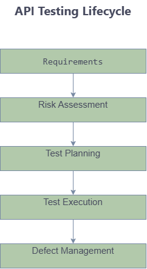

[🏠 Home](index.md)

# API Testing

## Why API Testing

API tests execute faster than UI tests and isolate backend functionality.

---

## API Testing Lifecycle

## Validation Areas

### Status Codes

200
201
400
401
403
404
500

### Response Validation

- Schema
- Fields
- Values

### Authentication

- OAuth
- JWT
- API Keys

---

## Test Types

### Smoke

Critical endpoint validation.

### Regression

Full endpoint coverage.

### Security

Authentication and authorization validation.

---

## Navigation

| Previous | Home | Next |
|-----------|------|------|
| [Test Strategy](test-strategy.md) | [Home](index.md) | [Quality Metrics](quality-metrics.md) |

---