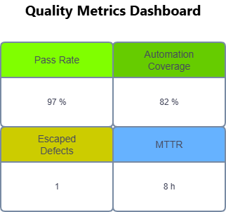

[🏠 Home](index.md)

# Quality Metrics

## Defect Density

Defects per story, feature, or release.

---

## Escaped Defects

Defects found in production.

---

## Automation Coverage

Automated tests divided by total tests.

---

## Pass Rate

Passed Tests / Executed Tests

---

## MTTD

Mean Time To Detect

---

## MTTR

Mean Time To Resolve

---

## Quality Dashboard Example

---

## Navigation

| Previous | Home | Next |
|-----------|------|------|
| [API Testing](api-testing.md) | [Home](index.md) | [Root Cause Analysis](root-cause-analysis.md) |

---