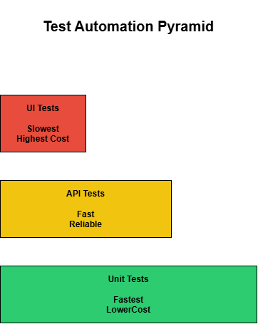

[🏠 Home](index.md)

# Test Automation Architecture

## Goals

- Faster feedback
- Repeatability
- Increased coverage
- Reduced manual effort

---

## Test Automation Pyramid

The automation pyramid prioritizes fast and reliable automated tests while minimizing dependency on slower UI tests.

### Unit Tests

Fastest execution.

### API Tests

Fast and reliable.

### UI Tests

User workflow validation.

---

## Framework Design

### Layer 1

Test Data

### Layer 2

Page Objects

### Layer 3

Business Logic

### Layer 4

Test Suites

---

## Recommended Tools

### UI

- Playwright
- Selenium

### API

- Postman
- Playwright

### CI/CD

- GitHub Actions
- Azure DevOps