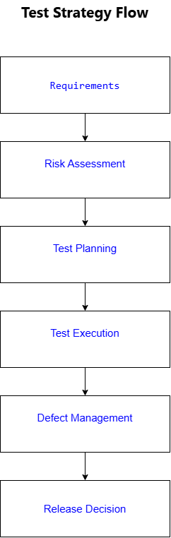

[🏠 Home](index.md)

# Test Strategy

## Test Strategy Flow

## Purpose

A Test Strategy defines the overall quality approach for a software project.

## Objectives

- Verify business requirements
- Prevent production defects
- Reduce delivery risk
- Improve release quality

---

## Test Levels

### Unit Testing

Validates individual functions or methods.

### Integration Testing

Validates interactions between components.

### System Testing

Validates end-to-end workflows.

### User Acceptance Testing

Validates business requirements.

---

## Risk-Based Testing

Examples:

| Risk | Priority |
|--------|--------|
| Payment Processing | High |
| Authentication | High |
| User Preferences | Medium |
| Reporting Dashboard | Low |

---

## Exit Criteria

- All critical defects resolved
- Test execution completed
- Business acceptance achieved

---

## Navigation

| Home | Next |
|-----------|------|
| [Home](index.md) | [API Testing](api-testing.md) |

---